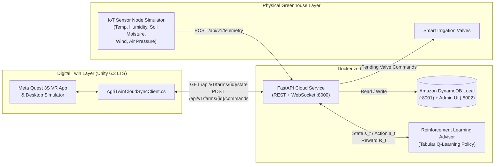

# AgriTwin Cloud Data Management Server (Docker + DynamoDB + RL Advisor)

This repository contains the **Dockerized Cloud Service Provider, Amazon DynamoDB State Engine, Reinforcement Learning Irrigation Advisor, and Physical Greenhouse IoT Sensor Simulator** for the **AgriTwin Valley Meta Quest 3S Digital Twin**.

## System Architecture



---

## Quick Start (Docker Compose)

1. **Install Docker Desktop** (Windows / macOS / Linux) and ensure it is running.
2. Open a terminal in this directory (`Server/` or repository root) and run:
   ```bash
   docker compose up --build -d
   ```
3. Verify the running services:
   - **Cloud API & Interactive Swagger Docs:** [http://localhost:8000/docs](http://localhost:8000/docs)
   - **Health Check:** [http://localhost:8000/health](http://localhost:8000/health)
   - **DynamoDB Web Admin UI:** [http://localhost:8002](http://localhost:8002)
   - **Live Twin State Endpoint:** [http://localhost:8000/api/v1/farms/MaeFahLuang_Greenhouse_01/state](http://localhost:8000/api/v1/farms/MaeFahLuang_Greenhouse_01/state)

4. View live IoT telemetry & Reinforcement Learning policy logs:
   ```bash
   docker compose logs -f iot-sensor-simulator agritwin-api
   ```

---

## Running Without Docker (Local Python Fallback)

If Docker Desktop is not installed on a machine, the server automatically falls back to an **In-Memory DynamoDB Store** so you can still test the REST API and RL Advisor directly:

```bash
pip install -r requirements.txt
uvicorn app.main:app --host 0.0.0.0 --port 8000 --reload
```

In a second terminal, start the simulated physical greenhouse sensors:
```bash
python simulator/iot_sensor_simulator.py
```

---

## Unity Meta Quest 3S Integration (`AgriTwinCloudSyncClient.cs`)

- Attached automatically to `AgriTwin_SystemRoot` in `Assets/Scenes/AgriTwinValley.unity`.
- Polls `http://localhost:8000/api/v1/farms/MaeFahLuang_Greenhouse_01/state` every `2.5s` (or connects to your LAN/Cloud IP when running untethered on Meta Quest 3S).
- When the player clicks **Irrigate Zone** in VR or places a **Grid Building** (`WaterTower`, `SensorNode`, `DronePad`, `Greenhouse`), Unity immediately POSTs the command/building to the Cloud API and updates DynamoDB.
- If the Docker server is offline, Unity seamlessly runs on its built-in local 24-hour historical telemetry simulation.
